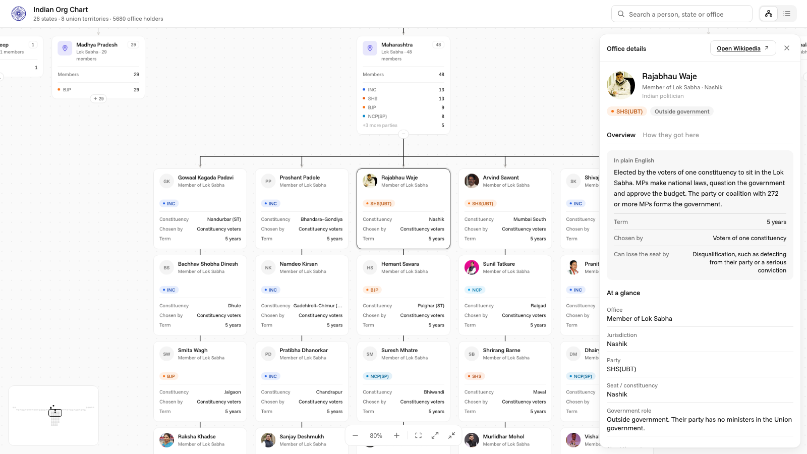

# Indian Org Chart

**See who runs India, and who answers to whom.**

An interactive chart of Indian politics, from the President down to your local MLA. Click any card to learn what the office does, how the person got there, and which party they belong to, in plain English.

**Open it:**

- [indian-org-chart.vercel.app](https://indian-org-chart.vercel.app) (Vercel)
- [siddharthsimharaju.github.io/Indian-org-chart](https://siddharthsimharaju.github.io/Indian-org-chart/) (GitHub Pages)


## What's in it

| Level | Who |
| --- | --- |
| The Union | President, Vice President, Prime Minister, Union ministers, Chief Justice, Chief Election Commissioner, Attorney General |
| Parliament | All 543 Lok Sabha members and 245 Rajya Sabha members, grouped by state |
| Each state and Union Territory | Governor (or Lieutenant Governor), Chief Minister, ministers, and every MLA grouped by district |

About 5,700 people in total, each with their party and, where Wikipedia has them, a photo and a one-line description.



## How to use it

- **Click the + on a card** to open the level below it. The chart centres on that card.
- **Click a card** to open its details: what the role means, how long the term is, who can remove them, and what the party stands for.
- **Search** for any person, state or office. Press `/` to jump to the search box.
- **Drag** to move around, and press ⌘/Ctrl and scroll to zoom.
- **Switch to list view** (the icon next to search) to see everyone in a table.

## What it doesn't cover

Local-body leaders (mayors, panchayat heads), civil servants and party office-bearers are not included. State upper houses (MLCs) are not added yet. Data is a snapshot, so some details may be out of date.

## Run it yourself

```sh
npm install
npm start          # opens at http://localhost:5173
```

To refresh the data from Wikipedia:

```sh
npm run build:data
```

## Where the data comes from

Names, parties, constituencies, photos and descriptions come from [Wikipedia](https://en.wikipedia.org) (CC BY-SA 4.0). The plain-English explanations are written for this project and live in `public/explain.js`. Constitutional facts such as seat counts and capitals are in `scripts/static-facts.mjs`.

## For developers

It's a plain static site with no build step. `public/` holds everything that is served. Pushing to `main` publishes it to GitHub Pages through `.github/workflows/pages.yml`. To update Vercel, run `vercel deploy --prod` from the `public/` folder.
