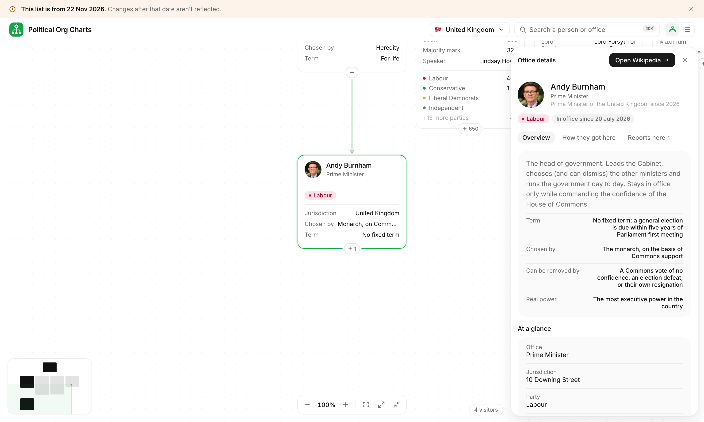

# Political Org Charts

**See who runs a country, and who answers to whom.**

Interactive org charts of national politics, from the head of state down to legislators. Pick a country, click any card, and learn what the office does, how the person got there, and which party they belong to, in plain English.

**Open it:**

- [indian-org-chart.vercel.app](https://indian-org-chart.vercel.app) (Vercel)
- [siddharthsimharaju.github.io/Indian-org-chart](https://siddharthsimharaju.github.io/Indian-org-chart/) (GitHub Pages)

Use the country dropdown in the top bar to switch. A link like `?c=usa` opens a specific country.


## Countries

| Country | What's in it | Data check |
| --- | --- | --- |
| 🇬🇧 United Kingdom | Monarch, Prime Minister, Cabinet, all 650 MPs, the House of Lords, the Supreme Court | Passed |
| 🇨🇦 Canada | Monarch, Governor General, Prime Minister, Cabinet, 337 MPs, the Senate, the Supreme Court, 13 premiers | Passed |
| 🇫🇷 France | President, Prime Minister, government, all deputies and senators, the Constitutional Council | Passed |
| 🇩🇪 Germany | President, Chancellor, Cabinet, all 630 Bundestag members, the Bundesrat, the Constitutional Court, 16 state leaders | Passed |
| 🇯🇵 Japan | Emperor, Prime Minister, Cabinet, both houses of the Diet, the Supreme Court, 47 governors | Passed |
| 🇺🇸 United States | President, Cabinet, Congress, the Supreme Court, all 50 governors and lieutenant governors, state legislatures, territories | Two checks done; corrections in progress |
| 🇮🇳 India | President, Prime Minister, Union ministers, Parliament, Governors, Chief Ministers, ministers and MLAs of every state | Rebuilt; not yet fact-checked |

About 5,700 people for India, 8,000 for the US, and between 500 and 1,500 for each of the others.




## How accurate is it?

Names, parties and seats come from official sources where a machine-readable list exists (for example the UK Parliament's Members API, the Canadian House of Commons member list, the French Assembly and Senate open data, the Bundestag member file) and from Wikipedia otherwise. Every country is then checked by a fact-checking agent that compares the data with official or independent sources and has to end with a PASS before a country is called done. Most checks found real errors on the first rounds, so each country went through several.

Things to know:

- **It is a snapshot.** The data date is shown in the banner at the top. Offices change, and election results often take effect weeks later.
- **Some details are marked unconfirmed** when an official page could not be reached. The chart says so on the card or in the summary instead of guessing.
- **State legislators in the US** come mainly from Wikipedia. They have been checked against official sites for only a few states.
- **Party labels** for appointed ministers are left blank where no official source states them.

## How to use it

- **Switch country** with the dropdown in the top bar.
- **Click the + on a card** to open the level below it. The chart centres on that card.
- **Click a card** to open its details: what the role means, how long the term is, who can remove them, and what the party stands for.
- **Search** for any person or office. Press `/` or ⌘K (Ctrl K on Windows) to jump to the search box.
- **Drag** to move around, and press ⌘/Ctrl and scroll to zoom.
- **Use the two icons beside the search box** to switch between the tree and the list view.

## What it doesn't cover

Local-body leaders (mayors, panchayat heads, county officials), civil servants and party office-bearers are not included. Countries beyond the seven above are not added yet. For India, state upper houses (MLCs) are not added.

## Run it yourself

```sh
npm install
npm start          # opens at http://localhost:5173
```

To refresh the data from Wikipedia and official sources:

```sh
npm run build:data     # India and the US
npm run verify         # structural checks for every country
node scripts/build-country.mjs uk canada   # the generic countries, by id
```

Requests are cached in `.cache`, so a rebuild after the first one is fast. A cold US build takes about 90 minutes because of Wikipedia's rate limits.

## Where the data comes from

Names, parties, constituencies, photos and short descriptions come from [Wikipedia](https://en.wikipedia.org) (CC BY-SA 4.0), and from the official sources listed in each country's spec under `scripts/countries/`. The plain-English explanations are written for each country and live in `public/countries/` (India and the US) or in the country's data file (the others). Constitutional facts such as seat counts and capitals are in `scripts/static-facts.mjs` (India), `scripts/us-facts.mjs` (US) and each country's spec.

Wikipedia is only as good as its latest edit, so check the linked article for anything important.

## For developers

It's a plain static site with no build step. `public/` holds everything that is served. Pushing to `main` publishes it to GitHub Pages through `.github/workflows/pages.yml`. To update Vercel, run `vercel deploy --prod` from the `public/` folder.

### Add a country

1. Write a spec in `scripts/countries/<id>.mjs` (see `scripts/country-facts-schema.md` and an existing spec such as `uk.mjs`) and build it with `node scripts/build-country.mjs <id>`. The tree is made of `group`, `house` and `office` nodes. Use official machine-readable member lists wherever one exists.
2. Run `npm run verify` for the structural checks.
3. Run the `country-fact-checker` agent (in Claude Code: ask it to check the new country). It verifies the hierarchy, constants, officeholders and plain-English text against official sources and ends with `VERDICT: PASS` or `FAIL`. Fix what it finds and repeat until it passes. The agent is defined in `.claude/agents/country-fact-checker.md`.

India and the US use their own config in `public/countries/` and their own builders; every other country needs only a spec.
