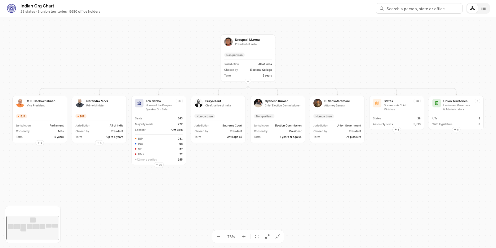

# Political Org Charts

**See who runs a country, and who answers to whom.**

Interactive org charts of national politics, from the head of state down to local legislators. Pick a country, click any card, and learn what the office does, how the person got there, and which party they belong to, in plain English.

Countries so far: 🇮🇳 India and 🇺🇸 United States.

**Open it:**

- [indian-org-chart.vercel.app](https://indian-org-chart.vercel.app) (Vercel)
- [siddharthsimharaju.github.io/Indian-org-chart](https://siddharthsimharaju.github.io/Indian-org-chart/) (GitHub Pages)

Use the country pill in the top bar to switch. A link like `?c=usa` opens a specific country.



## What's in it

### India

| Level | Who |
| --- | --- |
| The Union | President, Vice President, Prime Minister, Union ministers, Chief Justice, Chief Election Commissioner, Attorney General |
| Parliament | All 543 Lok Sabha members and 245 Rajya Sabha members, grouped by state |
| Each state and Union Territory | Governor (or Lieutenant Governor), Chief Minister, ministers, and every MLA grouped by district |

About 5,700 people in total.

### United States

| Level | Who |
| --- | --- |
| Executive | President, Vice President, and the Cabinet |
| Congress | Every member of the House (plus delegates) and all 100 senators, grouped by state |
| Judiciary | The nine Supreme Court justices |
| Each state | Governor, Lieutenant Governor, and both chambers of the state legislature |
| Territories | The Washington, D.C. mayor and the governors of the five inhabited territories |

About 8,000 people in total. State legislators are included wherever Wikipedia's member tables could be read reliably (7,326 of 7,386 seats at the last build).

Each person comes with their party and, where Wikipedia has them, a photo and a one-line description.


## How to use it

- **Switch country** with the pill next to the title.
- **Click the + on a card** to open the level below it. The chart centres on that card.
- **Click a card** to open its details: what the role means, how long the term is, who can remove them, and what the party stands for.
- **Search** for any person, state or office. Press `/` to jump to the search box.
- **Drag** to move around, and press ⌘/Ctrl and scroll to zoom.
- **Switch to list view** (the icon next to search) to see everyone in a table.

## What it doesn't cover

Local-body leaders (mayors, panchayat heads, county officials), civil servants and party office-bearers are not included. For India, state upper houses (MLCs) are not added yet. For the US, other statewide elected officials (attorneys general, secretaries of state and so on) and a few state legislative seats are missing. Data is a snapshot, so some details may be out of date.

## Run it yourself

```sh
npm install
npm start          # opens at http://localhost:5173
```

To refresh the data from Wikipedia:

```sh
npm run build:data     # both countries
npm run build:india    # or one at a time
npm run build:usa
```

Requests are cached in `.cache`, so a rebuild after the first one is fast. A cold US build takes about 90 minutes because of Wikipedia's rate limits.

## Where the data comes from

Names, parties, constituencies, photos and descriptions come from [Wikipedia](https://en.wikipedia.org) (CC BY-SA 4.0). The plain-English explanations are written for each country and live in `public/countries/`. Constitutional facts such as seat counts and capitals are in `scripts/static-facts.mjs` (India) and `scripts/us-facts.mjs` (US).

Wikipedia is only as good as its latest edit, so check the linked article for anything important. For example, a person's party comes from their own infobox and can be missing or out of date.

## For developers

It's a plain static site with no build step. `public/` holds everything that is served. Pushing to `main` publishes it to GitHub Pages through `.github/workflows/pages.yml`. To update Vercel, run `vercel deploy --prod` from the `public/` folder.

### Add a country

1. Write a data builder in `scripts/` (copy `build-usa.mjs`) that writes `public/data/<id>.json`. The tree is made of `group`, `house` and `office` nodes; see the existing files for the shape.
2. Add `public/countries/<id>.js`: the config for icons, colours, plain-English text, which roles are leaf cards and how the list view is grouped. `usa.js` is the shortest example.
3. Register it in `public/countries/index.js`.
4. Run `npm run verify` for the structural checks, then run the `country-fact-checker` agent (in Claude Code: ask it to check the new country). It verifies the hierarchy, constants, officeholders and plain-English text against official sources and ends with `VERDICT: PASS` or `FAIL`. Fix what it finds before shipping. The agent is defined in `.claude/agents/country-fact-checker.md`.
